<h1 align="center" style="border-bottom: none">
    AXIS IP Camera Universal Orchestrator Extension
</h1>

<p align="center">
  <!-- Badges -->

<a href="https://github.com/Keyfactor/axis-ipcamera-orchestrator/releases"></a>


</p>

<p align="center">
  <!-- TOC -->
  <a href="#support">
    <b>Support</b>
  </a>
  ·
  <a href="#installation">
    <b>Installation</b>
  </a>
  ·
  <a href="#license">
    <b>License</b>
  </a>
  ·
  <a href="https://github.com/orgs/Keyfactor/repositories?q=orchestrator">
    <b>Related Integrations</b>
  </a>
</p>

## Overview

The AXIS IP Camera Orchestrator extension remotely manages certificates on AXIS IP Network Cameras. This
orchestrator extension inventories certificates on the camera's certificate store, and it also supports adding new identity certificates and adding/removing CA certificates.
New identity certificates are created in the AXIS camera certificate store via On Device Key Generation (ODKG), also known as Reenrollment.
This means that certificates cannot be directly added to the AXIS camera, but instead the keypair is generated on the AXIS device and a certificate is issued for that keypair via a CSR submitted to Command for enrollment. 
This workflow is completely automated in the AXIS IP Camera Orchestrator extension. CA certificates can be added to the camera from uploaded CA certificates in Command.

### Use Cases

#### Supported

1. Inventory of identity & CA certificates 
2. Enrollment of identity certificates with ability to bind the certificate for a specific usage*
3. Ability to remove CA certificates from the camera
4. Ability to add CA certificates to the camera

#### Not Supported

1. Ability to remove identity certificates from the camera
2. Ability to add identity certificates to the camera

\* Certificates can be bound to the following usages: **HTTPS**, **IEEE802.X**, **MQTT**. Selecting **Other** enrolls a certificate without binding it to a usage, so it can be assigned later in the AXIS Network Camera GUI.

## Compatibility

This integration is compatible with Keyfactor Universal Orchestrator version 25.4 and later.

## Support

The AXIS IP Camera Universal Orchestrator extension is supported by Keyfactor. If you require support for any issues or have feature request, please open a support ticket by either contacting your Keyfactor representative or via the Keyfactor Support Portal at https://support.keyfactor.com.

> If you want to contribute bug fixes or additional enhancements, use the **[Pull requests](../../pulls)** tab.

## Requirements & Prerequisites

Before installing the AXIS IP Camera Universal Orchestrator extension, we recommend that you install [kfutil](https://github.com/Keyfactor/kfutil). Kfutil is a command-line tool that simplifies the process of creating store types, installing extensions, and instantiating certificate stores in Keyfactor Command.

1. Out of the box, an AXIS IP Network Camera will typically have configured an **Administrator** account. It is 
recommended to create a new account specifically for executing API calls. This account will need \'Administrator\' 
privileges since the orchestrator extension is capable of making configuration changes, such as installing and removing certificates.

### Camera Compatibility

Supported on AXIS cameras running AXIS OS 11.6 or later. Available LTS tracks vary by camera model.

- **Tested model:** AXIS M2035-LE Bullet Camera
- **Tested AXIS OS version:** 12.2.62

Has not been tested with any other model or firmware version.

### Authentication

The Axis IP Camera Orchestrator Extension uses .NET HttpClientHandler credential negotiation when connecting to Axis devices over HTTP or HTTPS.
This allows the orchestrator to automatically negotiate the authentication mechanism required by the camera.
The orchestrator has been validated against Axis cameras configured with:

- Basic
- Digest
- Basic & Digest
- Recommended

As a result, customer-side changes to camera authentication policies are generally not required.

## AxisIPCamera Certificate Store Type

To use the AXIS IP Camera Universal Orchestrator extension, you **must** create the AxisIPCamera Certificate Store Type. This only needs to happen _once_ per Keyfactor Command instance.

The AXIS IP Camera certificate store type represents a certificate store on an AXIS network camera
that maintains two separate collections of certificates:
* Identity certificates (certs with private keys)
* CA certificates

It is expected that there be one (1) certificate store managed per AXIS network camera.

#### Axis IP Camera Requirements

1. User Account with \'Administrator\' privileges and password to access the camera
2. Camera serial number
3. Camera IP address

#### Supported Operations

| Operation    | Is Supported |
|--------------|--------------|
| Add          | ✅ Checked |
| Remove       | ✅ Checked |
| Discovery    | 🔲 Unchecked |
| Reenrollment | ✅ Checked |
| Create       | 🔲 Unchecked |

#### Store Type Creation

##### Using kfutil:
`kfutil` is a custom CLI for the Keyfactor Command API and can be used to create certificate store types.
For more information on [kfutil](https://github.com/Keyfactor/kfutil) check out the [docs](https://github.com/Keyfactor/kfutil?tab=readme-ov-file#quickstart)

   <details><summary>Click to expand AxisIPCamera kfutil details</summary>

   ##### Using online definition from GitHub:
   This will reach out to GitHub and pull the latest store-type definition
   ```shell
   # Axis IP Camera
   kfutil store-types create AxisIPCamera
   ```

   ##### Offline creation using integration-manifest file:
   If required, it is possible to create store types from the [integration-manifest.json](./integration-manifest.json) included in this repo.
   You would first download the [integration-manifest.json](./integration-manifest.json) and then run the following command
   in your offline environment.
   ```shell
   kfutil store-types create --from-file integration-manifest.json
   ```
   </details>

#### Manual Creation
Below are instructions on how to create the AxisIPCamera store type manually in
the Keyfactor Command Portal

   <details><summary>Click to expand manual AxisIPCamera details</summary>

   Create a store type called `AxisIPCamera` with the attributes in the tables below:

   ##### Basic Tab
   | Attribute | Value | Description |
   | --------- | ----- | ----- |
   | Name | Axis IP Camera | Display name for the store type (may be customized) |
   | Short Name | AxisIPCamera | Short display name for the store type |
   | Capability | AxisIPCamera | Store type name orchestrator will register with. Check the box to allow entry of value |
   | Supports Add | ✅ Checked | Indicates that the Store Type supports Management Add |
   | Supports Remove | ✅ Checked | Indicates that the Store Type supports Management Remove |
   | Supports Discovery | 🔲 Unchecked | Indicates that the Store Type supports Discovery |
   | Supports Reenrollment | ✅ Checked | Indicates that the Store Type supports Reenrollment |
   | Supports Create | 🔲 Unchecked | Indicates that the Store Type supports store creation |
   | Needs Server | ✅ Checked | Determines if a target server name is required when creating store |
   | Blueprint Allowed | 🔲 Unchecked | Determines if store type may be included in an Orchestrator blueprint |
   | Uses PowerShell | 🔲 Unchecked | Determines if underlying implementation is PowerShell |
   | Requires Store Password | 🔲 Unchecked | Enables users to optionally specify a store password when defining a Certificate Store. |
   | Supports Entry Password | 🔲 Unchecked | Determines if an individual entry within a store can have a password. |

   The Basic tab should look like this:

   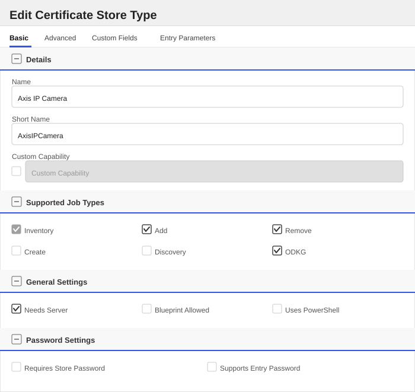

   ##### Advanced Tab
   | Attribute | Value | Description |
   | --------- | ----- | ----- |
   | Supports Custom Alias | Required | Determines if an individual entry within a store can have a custom Alias. |
   | Private Key Handling | Forbidden | This determines if Keyfactor can send the private key associated with a certificate to the store. |
   | PFX Password Style | Default | 'Default' - PFX password is randomly generated, 'Custom' - PFX password may be specified when the enrollment job is created (Requires the Allow Custom Password application setting to be enabled.) |

   The Advanced tab should look like this:

   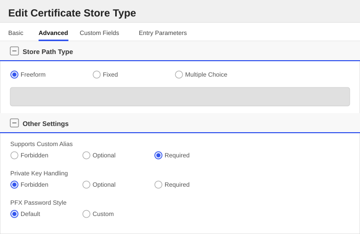

   > For Keyfactor **Command versions 24.4 and later**, a Certificate Format dropdown is available with PFX and PEM options. Ensure that **PFX** is selected, as this determines the format of new and renewed certificates sent to the Orchestrator during a Management job. Currently, all Keyfactor-supported Orchestrator extensions support only PFX.

   ##### Custom Fields Tab
   Custom fields operate at the certificate store level and are used to control how the orchestrator connects to the remote target server containing the certificate store to be managed. The following custom fields should be added to the store type:

   | Name | Display Name | Description | Type | Default Value/Options | Required |
   | ---- | ------------ | ---- | --------------------- | -------- | ----------- |
   | ServerUsername | Server Username | Enter the username of the configured "service" user on the camera | Secret |  | ✅ Checked |
   | ServerPassword | Server Password | Enter the password of the configured "service" user on the camera | Secret |  | ✅ Checked |
   | ServerUseSsl | Use SSL | Select True or False depending on if SSL (HTTPS) should be used to communicate with the camera. | Bool | true | ✅ Checked |
   | BypassTlsValidation | Bypass TLS Validation | If true and 'Use SSL' is enabled, TLS certificate validation is skipped when connecting to the camera. Has no effect when 'Use SSL' is false. Only enable this when the camera's certificate cannot be trusted by the orchestrator server. | Bool | false | ✅ Checked |
   | HttpPort | HTTP Port | Optional. Port used to connect to the camera over HTTP, when 'Use SSL' is false. A port set here replaces any port in Client Machine. If blank, the port in Client Machine is used, or the default HTTP port (80) if Client Machine has no port. | String |  | 🔲 Unchecked |
   | HttpsPort | HTTPS Port | Optional. Port used to connect to the camera over HTTPS, when 'Use SSL' is true. A port set here replaces any port in Client Machine. If blank, the port in Client Machine is used, or the default HTTPS port (443) if Client Machine has no port. | String |  | 🔲 Unchecked |

   The Custom Fields tab should look like this:

   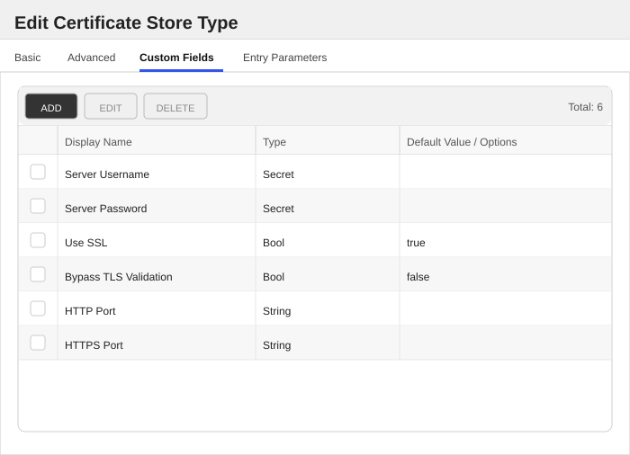

   ###### Server Username
   Enter the username of the configured "service" user on the camera


   > [!IMPORTANT]
   > This field is created by the `Needs Server` on the Basic tab, do not create this field manually.


   ###### Server Password
   Enter the password of the configured "service" user on the camera


   > [!IMPORTANT]
   > This field is created by the `Needs Server` on the Basic tab, do not create this field manually.


   ###### Use SSL
   Select True or False depending on if SSL (HTTPS) should be used to communicate with the camera.

   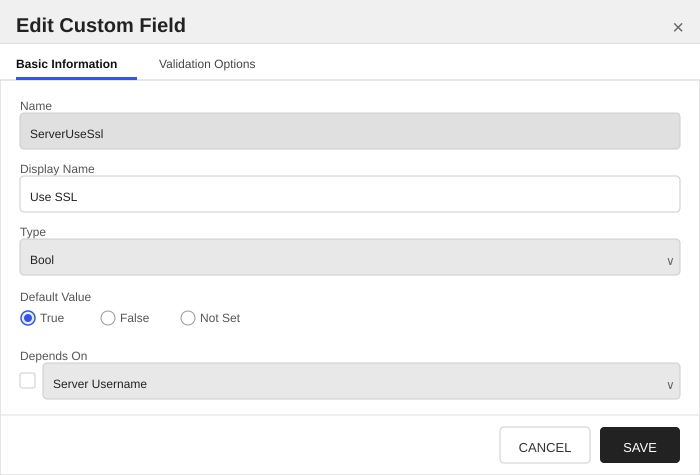
   


   ###### Bypass TLS Validation
   If true and 'Use SSL' is enabled, TLS certificate validation is skipped when connecting to the camera. Has no effect when 'Use SSL' is false. Only enable this when the camera's certificate cannot be trusted by the orchestrator server.

   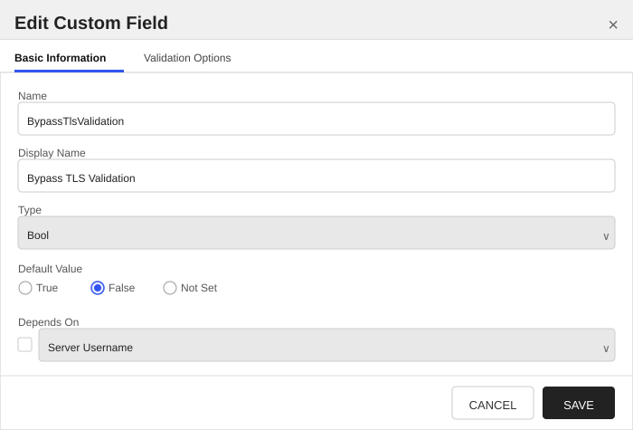
   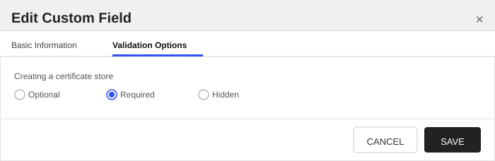


   ###### HTTP Port
   Optional. Port used to connect to the camera over HTTP, when 'Use SSL' is false. A port set here replaces any port in Client Machine. If blank, the port in Client Machine is used, or the default HTTP port (80) if Client Machine has no port.

   
   


   ###### HTTPS Port
   Optional. Port used to connect to the camera over HTTPS, when 'Use SSL' is true. A port set here replaces any port in Client Machine. If blank, the port in Client Machine is used, or the default HTTPS port (443) if Client Machine has no port.

   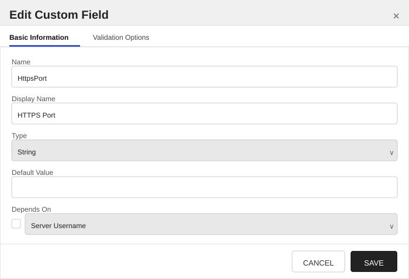
   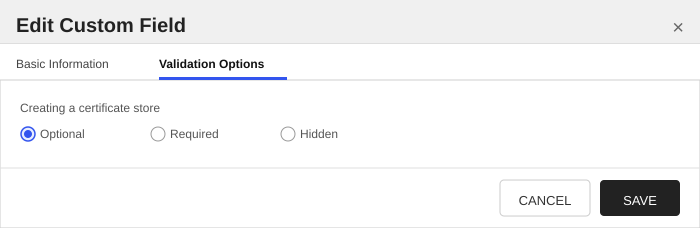


   ##### Entry Parameters Tab

   | Name | Display Name | Description | Type | Default Value | Entry has a private key | Adding an entry | Removing an entry | Reenrolling an entry |
   | ---- | ------------ | ---- | ------------- | ----------------------- | ---------------- | ----------------- | ------------------- | ----------- |
   | CertUsage | Certificate Usage | The Certificate Usage to assign to the cert after enrollment. Can be left 'Other' to be assigned later. | MultipleChoice |  | 🔲 Unchecked | ✅ Checked | 🔲 Unchecked | ✅ Checked |

   The Entry Parameters tab should look like this:

   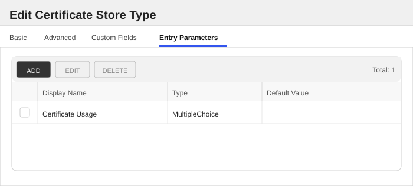
   ##### Certificate Usage
   The Certificate Usage to assign to the cert after enrollment. Can be left 'Other' to be assigned later.

   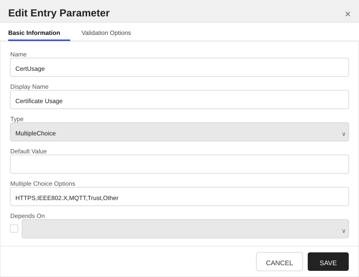
   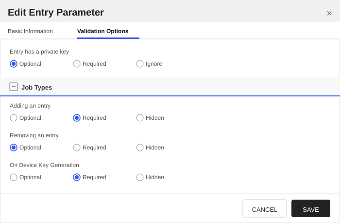


   </details>

## Installation

1. **Download the latest AXIS IP Camera Universal Orchestrator extension from GitHub.**

    Navigate to the [AXIS IP Camera Universal Orchestrator extension GitHub version page](https://github.com/Keyfactor/axis-ipcamera-orchestrator/releases/latest). Refer to the compatibility matrix below to determine which asset should be downloaded. Then, click the corresponding asset to download the zip archive.

   | Universal Orchestrator Version | Latest .NET version installed on the Universal Orchestrator server | `rollForward` condition in `Orchestrator.runtimeconfig.json` | `axis-ipcamera-orchestrator` .NET version to download |
   | --------- | ----------- | ----------- | ----------- |
   | Between `11.0.0` and `11.5.1` (inclusive) | `net8.0` | `LatestMajor` | `net8.0` |
   | `11.6` _and_ newer | `net8.0` | | `net8.0` |
   | `25.5` _and_ newer | `net10.0` | | `net10.0` |

    Unzip the archive containing extension assemblies to a known location.

    > **Note** If you don't see an asset with a corresponding .NET version, you should always assume that it was compiled for `net10.0`.

2. **Locate the Universal Orchestrator extensions directory.**

    * **Default on Windows** - `C:\Program Files\Keyfactor\Keyfactor Orchestrator\extensions`
    * **Default on Linux** - `/opt/keyfactor/orchestrator/extensions`

3. **Create a new directory for the AXIS IP Camera Universal Orchestrator extension inside the extensions directory.**

    Create a new directory called `axis-ipcamera-orchestrator`.
    > The directory name does not need to match any names used elsewhere; it just has to be unique within the extensions directory.

4. **Copy the contents of the downloaded and unzipped assemblies from __step 2__ to the `axis-ipcamera-orchestrator` directory.**

5. **Restart the Universal Orchestrator service.**

    Refer to [Starting/Restarting the Universal Orchestrator service](https://software.keyfactor.com/Core-OnPrem/Current/Content/InstallingAgents/NetCoreOrchestrator/StarttheService.htm).

6. **(optional) PAM Integration**

    The AXIS IP Camera Universal Orchestrator extension is compatible with all supported Keyfactor PAM extensions to resolve PAM-eligible secrets. PAM extensions running on Universal Orchestrators enable secure retrieval of secrets from a connected PAM provider.

    To configure a PAM provider, [reference the Keyfactor Integration Catalog](https://keyfactor.github.io/integrations-catalog/content/pam) to select an extension and follow the associated instructions to install it on the Universal Orchestrator (remote).

> The above installation steps can be supplemented by the [official Command documentation](https://software.keyfactor.com/Core-OnPrem/Current/Content/InstallingAgents/NetCoreOrchestrator/CustomExtensions.htm?Highlight=extensions).

## Defining Certificate Stores

### Store Creation

#### Manually with the Command UI

<details><summary>Click to expand details</summary>

1. **Navigate to the _Certificate Stores_ page in Keyfactor Command.**

    Log into Keyfactor Command, toggle the _Locations_ dropdown, and click _Certificate Stores_.

2. **Add a Certificate Store.**

    Click the Add button to add a new Certificate Store. Use the table below to populate the **Attributes** in the **Add** form.

   | Attribute | Description |
   | --------- | ----------- |
   | Category | Select "Axis IP Camera" or the customized certificate store name from the previous step. |
   | Container | Optional container to associate certificate store with. |
   | Client Machine | The IP address of the Camera. Sample is "192.167.231.174:44444". Include the port if necessary. |
   | Store Path | Enter the Serial Number of the camera e.g. `0b7c3d2f9e8a` |
   | Orchestrator | Select an approved orchestrator capable of managing `AxisIPCamera` certificates. Specifically, one with the `AxisIPCamera` capability. |
   | ServerUsername | Enter the username of the configured "service" user on the camera |
   | ServerPassword | Enter the password of the configured "service" user on the camera |
   | ServerUseSsl | Select True or False depending on if SSL (HTTPS) should be used to communicate with the camera. |
   | BypassTlsValidation | If true and 'Use SSL' is enabled, TLS certificate validation is skipped when connecting to the camera. Has no effect when 'Use SSL' is false. Only enable this when the camera's certificate cannot be trusted by the orchestrator server. |
   | HttpPort | Optional. Port used to connect to the camera over HTTP, when 'Use SSL' is false. A port set here replaces any port in Client Machine. If blank, the port in Client Machine is used, or the default HTTP port (80) if Client Machine has no port. |
   | HttpsPort | Optional. Port used to connect to the camera over HTTPS, when 'Use SSL' is true. A port set here replaces any port in Client Machine. If blank, the port in Client Machine is used, or the default HTTPS port (443) if Client Machine has no port. |

</details>

#### Using kfutil CLI

<details><summary>Click to expand details</summary>

1. **Generate a CSV template for the AxisIPCamera certificate store**

    ```shell
    kfutil stores import generate-template --store-type-name AxisIPCamera --outpath AxisIPCamera.csv
    ```
2. **Populate the generated CSV file**

    Open the CSV file, and reference the table below to populate parameters for each **Attribute**.

   | Attribute | Description |
   | --------- | ----------- |
   | Category | Select "Axis IP Camera" or the customized certificate store name from the previous step. |
   | Container | Optional container to associate certificate store with. |
   | Client Machine | The IP address of the Camera. Sample is "192.167.231.174:44444". Include the port if necessary. |
   | Store Path | Enter the Serial Number of the camera e.g. `0b7c3d2f9e8a` |
   | Orchestrator | Select an approved orchestrator capable of managing `AxisIPCamera` certificates. Specifically, one with the `AxisIPCamera` capability. |
   | Properties.ServerUsername | Enter the username of the configured "service" user on the camera |
   | Properties.ServerPassword | Enter the password of the configured "service" user on the camera |
   | Properties.ServerUseSsl | Select True or False depending on if SSL (HTTPS) should be used to communicate with the camera. |
   | Properties.BypassTlsValidation | If true and 'Use SSL' is enabled, TLS certificate validation is skipped when connecting to the camera. Has no effect when 'Use SSL' is false. Only enable this when the camera's certificate cannot be trusted by the orchestrator server. |
   | Properties.HttpPort | Optional. Port used to connect to the camera over HTTP, when 'Use SSL' is false. A port set here replaces any port in Client Machine. If blank, the port in Client Machine is used, or the default HTTP port (80) if Client Machine has no port. |
   | Properties.HttpsPort | Optional. Port used to connect to the camera over HTTPS, when 'Use SSL' is true. A port set here replaces any port in Client Machine. If blank, the port in Client Machine is used, or the default HTTPS port (443) if Client Machine has no port. |

3. **Import the CSV file to create the certificate stores**

    ```shell
    kfutil stores import csv --store-type-name AxisIPCamera --file AxisIPCamera.csv
    ```

</details>

#### PAM Provider Eligible Fields
<details><summary>Attributes eligible for retrieval by a PAM Provider on the Universal Orchestrator</summary>

If a PAM provider was installed _on the Universal Orchestrator_ in the [Installation](#Installation) section, the following parameters can be configured for retrieval _on the Universal Orchestrator_.

   | Attribute | Description |
   | --------- | ----------- |
   | ServerUsername | Enter the username of the configured "service" user on the camera |
   | ServerPassword | Enter the password of the configured "service" user on the camera |

Please refer to the **Universal Orchestrator (remote)** usage section ([PAM providers on the Keyfactor Integration Catalog](https://keyfactor.github.io/integrations-catalog/content/pam)) for your selected PAM provider for instructions on how to load attributes orchestrator-side.
> Any secret can be rendered by a PAM provider _installed on the Keyfactor Command server_. The above parameters are specific to attributes that can be fetched by an installed PAM provider running on the Universal Orchestrator server itself.

</details>

> The content in this section can be supplemented by the [official Command documentation](https://software.keyfactor.com/Core-OnPrem/Current/Content/ReferenceGuide/Certificate%20Stores.htm?Highlight=certificate%20store).

### Certificate Usage

Every certificate inventoried will have an Entry Parameter called \`Certificate Usage\`. 
There are five (5) possible options:

* **HTTPS**
* **IEEE802.X**
* **MQTT**
* **Trust**
* **Other**

1. HTTPS
   - This certificate usage describes the certificate bound to the camera's web server and presented on HTTPS connections (i.e. server certificate or SSL/TLS certificate).
2. IEEE802.X
   - This certificate usage describes the client certificate to authenticate the camera to a server using EAP-TLS. This client certificate
   is presented to the 802.1x radius server for authentication.
3. MQTT
   - This certificate usage describes the client certificate used to authenticate the camera to the MQTT broker.
   In this scenario, the camera connects to the MQTT broker over SSL and performs a TLS handshake.
   The camera presents this client certificate to the MQTT broker.
4. Trust
   - This certificate usage describes a public certificate issued by a CA used to establish trust. 
5. Other
   - This certificate usage identifies all other certificates on the camera that do not fall under the pre-defined usages above.


## Device Onboarding

Cameras are typically provisioned with a self-signed or otherwise untrusted device identity certificate. The
**Use SSL** and **Bypass TLS Validation** certificate store properties together determine what's required to
connect successfully:

| Use SSL | Bypass TLS Validation | Behavior |
| --- | --- | --- |
| `False` | *(any)* | Connects over plain HTTP. There is no TLS handshake, so certificate trust does not apply, and **Bypass TLS Validation** has no effect either way. |
| `True` | `True` | Connects over HTTPS but skips certificate validation entirely - any certificate is accepted, including the camera's untrusted factory certificate. |
| `True` | `False` | Connects over HTTPS and validates the certificate like any other TLS connection - see below for what's required to pass. |

> [!WARNING]
> It is highly recommended to keep **Use SSL** enabled. Plain HTTP sends credentials and certificate data to
> the camera unencrypted, and is only intended as a fallback for cameras or networks that cannot support HTTPS.

> [!NOTE]
> **Use SSL = False** requires the camera itself to also be configured to accept plain HTTP connections. AXIS
> cameras can independently be restricted to HTTPS-only access; if so, connections will fail regardless of this
> setting until the camera's own network settings are changed to allow HTTP.

> [!NOTE]
> The orchestrator connects on port 80 (HTTP) or 443 (HTTPS), unless **Client Machine** includes a port (e.g.
> `10.0.0.5:8443`). If the camera uses other ports, set **HTTPS Port** (used when **Use SSL** is `True`) and/or
> **HTTP Port** (used when **Use SSL** is `False`). A port set in either field replaces any port in **Client Machine**. Set
> both if you switch **Use SSL** between `True` and `False`.

> [!IMPORTANT]
> **Upgrading to 1.2.0:** before this version, **Use SSL** was ignored and the extension always connected over
> HTTPS. Stores with **Use SSL** set to `False` now connect over plain HTTP, and since **Client Machine** on
> existing stores usually holds the HTTPS port (or none), those connections will fail. Set **Use SSL** to `True`
> on these stores, or set **HTTP Port** to the camera's HTTP port and make sure the camera accepts HTTP.

> [!TIP]
> **AXIS Device ID CA certificates:** https://www.axis.com/support/public-key-infrastructure-repository

All network cameras come pre-loaded with one (1) or more device ID certificates - potentially using different
key algorithms (e.g. RSA, ECC) - and one of these is configured on the camera to be presented during the TLS
handshake to the client during an HTTPS request.

When **Use SSL** is `True` and **Bypass TLS Validation** is `False`, install the issuing intermediate and root
CAs (linked above) for whichever device ID certificate is currently bound to the camera's web server for HTTPS into the
orchestrator server's local trust store so that standard TLS validation succeeds. For instructions on
replacing the camera's factory certificate with one enrolled from the customer's own PKI, see
[Replacing the Factory Device ID Certificate](#replacing-the-factory-device-id-certificate) below.

### Camera-Specific Trust Validation

This only applies when **Use SSL** is `True` and **Bypass TLS Validation** is `False`.

The camera's factory certificate's CN/SAN reflects whatever hostname or IP it was given at manufacture, not
the camera's current network address - so connecting to the camera at its real, current address normally
fails with a standard TLS name mismatch, even once the issuing CAs above are trusted. To resolve this for the
factory certificate specifically:

- Enter the camera's serial number (shown in the camera's web UI) as the certificate store's **Store Path**
  value.
- If a name mismatch is the *only* problem (the certificate otherwise chains to a trusted CA), the orchestrator
  checks the certificate's `SERIALNUMBER` Subject DN attribute - a separate field that identifies the physical
  device regardless of network address - against that **Store Path** value. If they match, the mismatch is waived.
- This doesn't change anything about trust itself: a certificate that doesn't chain to a trusted CA still
  fails, regardless of **Store Path**.

> [!NOTE]
> This check only compares the certificate's `SERIALNUMBER` against the recorded **Store Path** value - it does
> not verify which CA issued the certificate. It is not intended to distinguish the camera's factory
> certificate from a customer-issued certificate that happens to carry the same value, for example due to a
> misconfigured enrollment.

> [!NOTE]
> This only applies while the camera presents its factory certificate. Once a customer-PKI certificate is
> enrolled via ODKG, standard TLS validation against the store's actual **Client Machine** value takes over, as
> described above.

> [!IMPORTANT]
> Inventory, Reenrollment (ODKG), and Management jobs all connect to the camera using the same HTTP/HTTPS
> connection, so **Bypass TLS Validation** affects all of them.

## Enrollment Behavior

The following enrollment behaviors are specific to ODKG (On Device Key Generation) — also known as Reenrollment — on AXIS cameras, and should be considered when designing certificate automation workflows.

### Replacing the Factory Device ID Certificate

To move the camera off its factory certificate, schedule an ODKG job and select **HTTPS** as the **Certificate Usage**. This enrolls a new certificate issued from the customer's own PKI and binds it to the camera's web server for HTTPS.

> [!IMPORTANT]
> After the ODKG job completes, make sure the orchestrator server trusts the newly enrolled certificate by installing its issuing intermediate and root CAs into the orchestrator server's local trust store. These are typically different CAs than the ones used for the camera's factory certificate.

> [!WARNING]
> An ODKG job with `HTTPS` as the **Certificate Usage** also sets the camera's web server to accept HTTPS only. If you use **Use SSL** = `False`, re-enable HTTP in the camera's network settings after enrolling. Enabling HTTP is not generally recommended, since credentials and certificate data are then sent to the camera unencrypted.

### Alias Versioning

AXIS cameras require each Alias to be unique, and each Alias is tightly coupled with the private key used to generate its certificate. Because of this, certificates cannot be reenrolled in place by replacing the certificate and private key associated with an existing Alias.

To support certificate renewals and automation workflows, the orchestrator generates a unique Alias by appending the following suffix:

`_yyMMddHHmm`

where `yyMMddHHmm` represents the current UTC date and time.

From an automation perspective, the same Alias can continue to be reused, as uniqueness is enforced by the integration.

> [!NOTE]
> As of v1.1.0, ODKG jobs automatically manage versioned Aliases. When reenrolling a certificate, the integration creates a new certificate using a versioned Alias, binds it to the selected **Certificate Usage**, and removes the certificate that was previously bound to that usage.
>
> Because AXIS cameras do not support in-place certificate replacement, when a certificate is already bound to the selected **Certificate Usage**, a new versioned Alias is created during reenrollment. The previous certificate is identified by its binding to the **Certificate Usage**, not by its Alias name, so the Alias supplied in the job does not need to match it.
>
> ODKG jobs never remove certificates that are not bound to the selected **Certificate Usage**. Because AXIS cameras have limited certificate and key storage capacity, users should periodically review and remove unused certificates through the AXIS Network Camera GUI.

> [!NOTE]
> Before removing the previous certificate, the integration checks whether its Alias is still bound to a
> *different* **Certificate Usage** (AXIS allows the same Alias to be assigned to multiple usages at once). If so,
> it's left in place rather than removed. On the very first reenrollment of a given **Certificate Usage**, the
> certificate being replaced is often the camera's untouched factory identity certificate, which AXIS does not
> allow removing at all - this is also expected and does not produce a Warning. Only an unexpected removal
> failure produces a Warning.

#### Configuration Example

The following example demonstrates how Alias versioning behaves in an ODKG job configuration:

- **Store Path:** camera serial number, e.g. `0b7c3d2f9e8a`
- **Overwrite:** `true` or `false` *(has no bearing on Alias or certificate behavior)*
- **Alias:** `https-cert` *(the base Alias; the camera shows the versioned Alias with a timestamp suffix)*
- **Certificate Usage:** any of `HTTPS`, `IEEE802.X`, `MQTT`, `Other` *(`Trust` is not supported for ODKG jobs — see [Certificate Usage Considerations (Trust)](#certificate-usage-considerations-trust) below)*

The following table shows how the Alias is handled in each scenario, using `https-cert` as the supplied Alias:

| Scenario | Alias on the camera | Previous certificate |
|---|---|---|
| **HTTPS**, **IEEE802.X** or **MQTT**, with a certificate already bound to that **Certificate Usage** | Versioned with a `_yyMMddHHmm` timestamp suffix, e.g. `https-cert_2508251200`. A later job with the same Alias creates `https-cert_2509031400`. | Removed after the new certificate is bound, regardless of its Alias. Left in place if it is still bound to another **Certificate Usage**, or if the camera does not allow removing it (e.g. the factory device ID certificate). |
| Same as above, but a different Alias is supplied than the bound certificate's | The supplied Alias with its own timestamp suffix | Removed, as above. The previous certificate is identified by its binding, not its Alias. |
| **MQTT**, with nothing bound yet | The supplied Alias, as is (no suffix), because there is no existing certificate for it to conflict with. A later job with the same Alias finds it bound and versions the new Alias. | None to remove |
| **Other** | Always versioned with a timestamp suffix. The integration can't look up what is bound for **Other**, so it can't tell whether the supplied Alias is already in use. A unique Alias avoids a conflict and lets the same Alias be reused in automated jobs. | Never removed. **Other** covers every certificate that isn't bound to HTTPS, IEEE802.X or MQTT. Such a certificate may be bound to something this integration doesn't manage, and there is no safe way to identify a "previous" one. Review and remove unused certificates in the AXIS Network Camera GUI. |
| **Trust** | Not supported for ODKG jobs; the job fails | None |

Operational behavior:
- The **Overwrite** setting has no effect on Alias or certificate behavior — AXIS cameras do not support in-place certificate replacement, so a new versioned Alias is created regardless of how Overwrite is set
- The certificate bound to the selected **Certificate Usage** is what the integration removes after enrolling the new one, regardless of its Alias name

### Certificate Usage Considerations (Trust)

> [!NOTE]
> If an ODKG job is configured with `Trust` selected as the **Certificate Usage**, the job fails with a message indicating that ODKG is not supported for that usage.
>
> Trust CA certificates must be installed using a **Management - Add** job. These certificates establish trust for TLS connections initiated by the camera.

### Certificate Usage Considerations (Other)

> [!NOTE]
> An ODKG job with `Other` selected as the **Certificate Usage** enrolls a certificate without binding it to a usage, so it can be assigned later in the AXIS Network Camera GUI. Because there is no bound certificate to replace, previously enrolled `Other` certificates are not removed automatically. AXIS cameras have limited certificate and key storage capacity, so review and remove unused certificates periodically through the AXIS Network Camera GUI.

### Subject Alternative Names (SANs)

As of Keyfactor Command v25.4, Subject Alternative Names (SANs) can be specified for ODKG jobs. Support for passing SANs to the orchestrator also requires, at minimum, Keyfactor Universal Orchestrator v25.1.

The AXIS camera's certificate management API only accepts DNS and IP SANs. Any other SAN types included in the ODKG job (for example email, URI, or UPN) are ignored and are not added to the enrolled certificate.

> [!NOTE]
> If no supported SANs are provided (none at all, or only unsupported types) and the selected **Certificate Usage** is `HTTPS`, IP and DNS SANs are automatically added to avoid TLS name-mismatch errors:
>
> - **IP** = The **Client Machine** configured for the certificate store (excluding any port number)
> - **DNS** = The Common Name (CN) specified in the certificate Subject DN
>
> This requires the **Client Machine** to be an IPv4 address and the Subject to include a CN; otherwise the job fails. Supply DNS or IP SANs explicitly to avoid this.

## Troubleshooting

### 401 Unauthorized Responses

The Axis IP Camera Orchestrator Extension supports authentication negotiation and has been validated against Axis cameras configured for:

- Basic
- Digest
- Basic & Digest
- Recommended

If a 401 Unauthorized response is encountered:

1. Verify the configured credentials.
2. Verify connectivity to the device.
3. Review orchestrator logs for authentication-related messages.

## Operational Notes

### AXIS OS 12 Firmware Recommendation

> [!IMPORTANT]
> Devices running the AXIS OS 12 release track should always be updated to the latest firmware version available from Axis. Previous firmware versions are no longer supported once a newer release becomes available.

Axis identified a memory leak in older firmware releases that may cause device keystore storage to become exhausted over time. If keystore storage issues are observed, verify that the device is running the latest supported firmware version.

## Release Notes

**1.2.0**
- Standardized device onboarding and TLS trust validation: **Use SSL** now actually controls whether the camera connection uses HTTP or HTTPS, a new **Bypass TLS Validation** certificate store property can skip certificate validation entirely, and the camera's factory certificate is now validated against the orchestrator server's standard local trust store instead of a bundled custom trust. Optional **HTTP Port** and **HTTPS Port** properties support cameras on non-default ports.
- Fixed Inventory reporting Success with zero certificates when the camera returned none.
- ODKG no longer reports a Warning on a camera's first reenrollment when the camera's factory certificate can't be removed, or when using the `Other` **Certificate Usage**. Corrected the Alias Versioning documentation to match the existing cleanup behavior.

**1.1.0**
- Improved exception handling to be more robust for HTTP client initialization.
- Implemented .NET native credential negotiation to support both Basic and Digest authentication policies.
- Fixed incorrect mapping of the ECDSA algorithm to ECP; updated to ECDSA.
- Implemented Alias versioning to enable reuse of existing Alias names in automation processes.
- Updated doctool release actions to v5.
- Updated .NET target frameworks to net8.0 and net10.0.

**1.0.2**
- Removed logging of plaintext cert store Server Password.
- Updated Keystore type to be dynamic instead of a fixed Enum, to allow compatibility across different cameras and firmware versions.

**1.0.1**
- Added screenshots to docs.

**1.0.0**
- Initial Public Version.

## License

Apache License 2.0, see [LICENSE](LICENSE).

## Related Integrations

See all [Keyfactor Universal Orchestrator extensions](https://github.com/orgs/Keyfactor/repositories?q=orchestrator).
